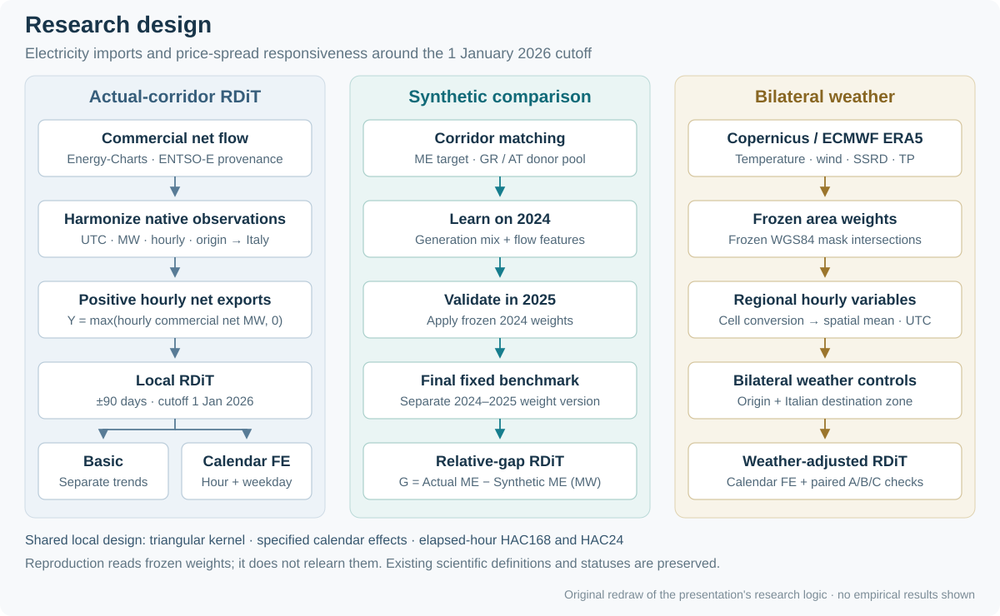
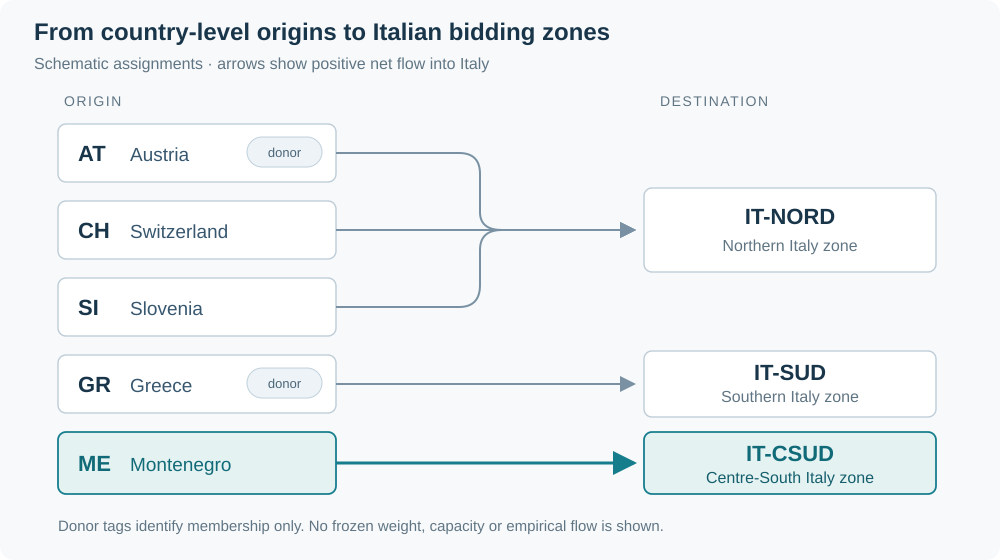
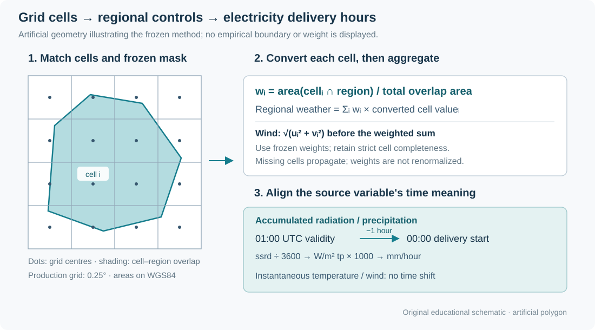
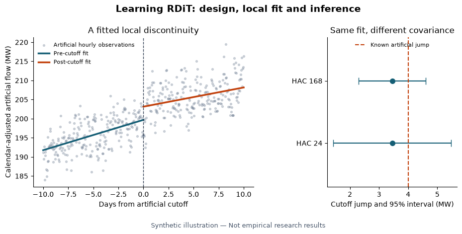
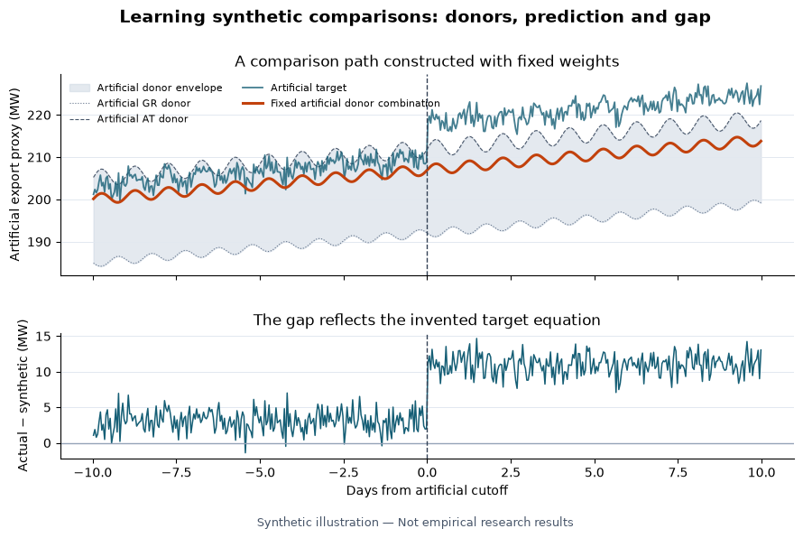

# Montenegro–Italy Electricity Trade Around the EU CBAM

An illustrated guide to the existing research design: electricity-market measurement, local discontinuities, a frozen synthetic benchmark and bilateral weather controls.

This page documents the research design already developed for the project presentation, *EU-CBAM and Electricity Imports* (`5324 Project Presentation v1014`, especially slides 5 and 7–13), and explained in the private V3 empirical teaching report. Its reading order follows that work: hypotheses, flow construction, weather aggregation, Basic/calendar/weather RDiT, then the synthetic benchmark and gap. Those documents inform the narrative; their empirical values and original graphics are not reproduced here. This Markdown file is the maintained source for the offline research website.

**V3 is the formal empirical baseline.** V3.1 adds presentation; V3.2 adds polynomial robustness. V2F supplies historical verification references. Earlier versions supply explicitly identified frozen upstream inputs. The documentation connects the presentation to those frozen definitions; it does not introduce a new research design or change the hierarchy.

The authoritative contracts are [`config/main.toml`](../config/main.toml), [`config/polynomial.toml`](../config/polynomial.toml) and [`manifests/baselines.toml`](../manifests/baselines.toml). The figures here are original schematics or artificial examples. They contain no empirical estimates, frozen donor weights or real boundary geometry.

## 1. The presentation's research question and three branches

CO₂ emissions create a negative externality when their social cost is not reflected in market prices. Carbon pricing can affect dispatch and import incentives. CBAM links covered imports to a carbon cost associated with embedded emissions, with certificate prices tied to the EU ETS and provisions recognizing carbon prices already paid abroad. Electricity is included; the definitive regime starts on 1 January 2026. This institutional date fixes the research cutoff. It does not establish that every corridor has the same regulatory exposure. [European Commission, definitive regime](https://taxation-customs.ec.europa.eu/carbon-border-adjustment-mechanism/cbam-definitive-regime_en)

The presentation asks whether CBAM reduces carbon-intensive electricity imports from non-EU countries. It develops two hypotheses: a fall in Montenegro-to-Italy imports around implementation, and reduced responsiveness of imports to price spreads as arbitrage becomes less attractive. The observed outcome is positive-part commercial net flow, not measured hourly carbon content. Demand, renewable availability, hydro conditions, transmission constraints and other contemporaneous events can also change trade. A local discontinuity is therefore distinct from a sustained annual change or an identified carbon-emissions effect.

The report motivates these hypotheses with an importer's stylized arbitrage margin:

$$
m_t=P^{destination}_t-P^{origin}_t-c^{capacity}_t-c^{loss}_t-c^{balancing}_t-c^{carbon}_t,
\qquad \max_{0\leq q_t\leq K_t}\{q_tm_t-C(q_t)\}.
$$

A higher carbon-related cost can reduce the margin at a given price spread, while a wider spread or changing constraints can offset it. Here $q_t$ is the import decision and $K_t$ available capacity. The cost terms and complete hourly availability are not observed well enough to estimate this as a structural model. It explains why flows might respond; it is not an additional fitted equation.



**Figure 1. The existing three-branch research design.** **Units:** methodological stages; MW for the flow and gap outcomes. **Interpretation:** follow actual-corridor RDiT, the historical synthetic learning/validation sequence, and the ERA5-to-weather-control branch. **Provenance:** original schematic redrawing the presentation's research logic and reconciling it with frozen source definitions. **Limits:** arrows show analytical dependencies, not causal identification or empirical effects; weight learning is historical and is not rerun by reproduction.

| Existing research branch | Presentation sequence | Frozen implementation |
|---|---|---|
| Actual-corridor RDiT | Commercial net exports → local RDiT → Basic and calendar fixed effects | Hourly positive net-flow outcome; common cutoff, trends, kernel and HAC conventions |
| Synthetic comparison | Corridor matching → 2024 weight learning → 2025 validation → synthetic relative gap | Frozen Greece/Austria donors; separate validation and final weight versions; actual-minus-synthetic gap RDiT |
| Bilateral weather | ERA5 grid → area intersections → regional hourly variables → bilateral controls → weather-adjusted RDiT | Frozen geographic weights, cell-level conversions and delivery-hour alignment; paired A/B/C comparisons |

The implementation details below make those existing steps explicit. Same-season F1/F2 and polynomial checks retain their existing supporting roles; they are not replacements for the presentation's local design.

### Presentation terminology and code crosswalk

| Presentation wording | Precise meaning used here |
|---|---|
| Electricity imports / net exports | Origin-to-Italy positive-part **hourly commercial net flow**; the same corridor viewed from the destination or origin. It is not gross imports. |
| ENTSO-E flow data | ENTSO-E upstream provenance, accessed through the exact frozen **Energy-Charts Italy-reporter mirror files**; no independent direct ENTSO-E acquisition is claimed. |
| “ESA Copernicus ERA5” | **Copernicus/ECMWF ERA5**. “ESA” is corrected as a presentation attribution error. |
| Calendar FE; “Hour-of-Date” | **Hour-of-day and weekday fixed effects**, using the Rome calendar. |
| “Weather FE” | Bilateral **continuous weather controls** and their specified nonlinear terms, not a new weather fixed-effect classification. |
| Synthetic “relative gap” | $G_t=Y^{ME}_t-Y^{syn}_t$ in **MW**. It is a level difference, not a ratio or percentage-normalized gap. |
| 2024 learning → 2025 validation | `GY050_train2024` provides that validation path; `GY050_final` separately uses historical 2024–2025 learning. Final weights must not be described as the 2024-only validation weights. |
| Alternative bandwidth “12 days” on slide 21 | The frozen V3 contract and estimator use **14 days**, alongside 30/60/90/180. The slide shorthand does not change the specification. |
| $\tau_G=\tau_{ME}-\tau_{syn}$ | A linear-estimator identity only under the same sample, design and weights. The gap is directly regressed and joint covariance retained; weather branches do not impose this identity on differing designs. |

Where a simplified slide label and frozen source differ, the verified source/configuration controls the computation. The presentation's qualitative results and discussion motivate interpretation, but this public teaching documentation does not reproduce empirical numerical claims or promote them into stronger causal conclusions.



**Figure 2. Geography of the analysis, shown schematically.** **Units:** country and bidding-zone identifiers; arrows have no quantitative scale. **Interpretation:** Montenegro is matched to IT-CSUD, Greece to IT-SUD, and Austria/Switzerland/Slovenia to IT-NORD; donor tags denote membership only. **Provenance:** original diagram from frozen corridor assignments, with no third-party boundary geometry. **Limits:** positions and line lengths are not geographic, and the figure contains no capacities, donor weights or observed trade.

## 2. Market variables, sources and inherited inputs

The five formal actual corridors are Austria, Switzerland, Slovenia, Greece and Montenegro into Italy. Austria/Switzerland/Slovenia use IT-NORD destination prices and weather, Greece uses IT-SUD, and Montenegro uses IT-CSUD. France is outside the formal actual-corridor set. Switzerland's synthetic branch remains blocked.

| Input | Frozen construction and lineage | Package entry point |
|---|---|---|
| Commercial and physical flows | Italy-reporter Energy-Charts archives with ENTSO-E upstream provenance; positive signed flow is into Italy; GW converted to MW | [`market.py`](../src/cbam_power/market.py) |
| Destination prices | Corridor bidding-zone prices, not PUN. AT/CH/ME retain frozen V1 GME destination values; the IT-CSUD mirror served validation, not gap filling. SI/GR use the selected GME archives | [`panel.py`](../src/cbam_power/panel.py), [`market.py`](../src/cbam_power/market.py) |
| Origin prices | AT/CH/ME values inherited from the frozen V1 panel; SI uses its frozen Energy-Charts mirror then SMARD gap fill; GR uses frozen HEnEx then its Energy-Charts mirror | [`panel.py`](../src/cbam_power/panel.py) |
| Generation mix | Frozen Eurostat `nrg_cb_pem` monthly net generation, complete-year checks and retained fuel definitions | [`synthetic.py`](../src/cbam_power/synthetic.py) |
| Weather | Frozen ERA5 NetCDF, requests, geography masks and intersection weights | [`weather.py`](../src/cbam_power/weather.py) |
| Synthetic weights | All 16 original ME versions, read from the full-precision frozen CSV | [`synthetic.py`](../src/cbam_power/synthetic.py) |

Provider references are [Energy-Charts](https://api.energy-charts.info/), [GME](https://www.mercatoelettrico.org/), [HEnEx](https://www.enexgroup.gr/), [SMARD](https://www.smard.de/en) and [Eurostat net generation](https://ec.europa.eu/eurostat/web/products-datasets/-/nrg_cb_pem). These links identify sources; they are not blanket redistribution permissions. File-level provenance and acquisition identities live in [`inputs.toml`](../manifests/inputs.toml); permission exceptions are documented in [data access](data_access.md).

For native intervals $j$ within delivery hour $t$, signed hourly power and energy are

$$
N_t=\frac{1}{60}\sum_j N_j\Delta m_j,
\qquad E_t=\sum_j N_j\frac{\Delta m_j}{60}.
$$

$N_j$ is MW and $\Delta m_j$ is observed minutes. Complete 60-minute coverage is required; overlaps are rejected and gaps are not extended. The equal numerical values of hourly average MW and one-hour MWh have different units. The primary outcome is $Y_t=\max(N_t,0)$, with the positive part applied **after hourly netting**. It is a positive net-export proxy, not gross exports. Signed commercial flow remains a sensitivity outcome; physical flow is kept separately.

The price spread is $S_t=P^{destination}_t-P^{origin}_t$ in EUR/MWh. Its centered form subtracts the frozen pre-2026 center. V1 AT/CH/ME observations and their inherited centers retain their actual upstream lineage; the package does not claim to reconstruct that entire historical chain from provider originals.

Delivery-start timestamps are UTC. Calendar variables use Europe/Rome, preserving both DST transitions. The cutoff is **2026-01-01 00:00 Europe/Rome**, or **2025-12-31 23:00 UTC**. The running variable uses the delivery midpoint, 30 minutes after the hourly start. Missing observations are not filled to manufacture a continuous sample.

## 3. ERA5 spatial and temporal construction

ERA5 is an ECMWF reanalysis distributed through the Copernicus Climate Data Store. Its hourly single-level product uses a regular 0.25° atmospheric grid; the project's exact frozen NetCDF versions are resolved by content identity. [ERA5 catalogue and dataset DOI](https://cds.climate.copernicus.eu/datasets/reanalysis-era5-single-levels?tab=overview)

The eight frozen geographic units are AT, CH, SI, GR, ME, IT-NORD, IT-CSUD and IT-SUD. Italian bidding-zone proxies retain the original definitions. For grid cell $C_i$ and region $G_g$,

$$
w_{ig}=\frac{A(C_i\cap G_g)}{\sum_j A(C_j\cap G_g)},
\qquad W_{g,t}=\sum_i w_{ig}W_{i,t}.
$$

Areas use WGS84 geodesic cell/polygon intersections. The production calculation reads the frozen weights unchanged; independent geometry checks do not replace them. Required cells, coordinates and normalized positive weights must match exactly. Missing weather propagates without renormalizing over the remaining cells.



**Figure 3. From ERA5 grid cells to delivery-hour weather.** **Units:** production-grid spacing in degrees; regional outputs in °C, m/s, W/m² and mm/hour. **Interpretation:** intersect cells with a frozen geographic mask, convert grid values, aggregate using frozen area weights, and align accumulated variables to delivery start. **Provenance:** original artificial polygon/grid illustration of the implemented method. **Limits:** this is not an actual geography or set of empirical weights; missing cells remain missing rather than receiving redistributed weights.

| Variable | Cell-level conversion | Timestamp rule |
|---|---|---|
| Temperature | `t2m − 273.15`, °C | Instantaneous validity time retained |
| Wind | `sqrt(u10² + v10²)`, m/s, **before spatial averaging** | Instantaneous validity time retained |
| Solar radiation | `ssrd / 3600`, W/m² for the preceding hour | Validity time minus one hour |
| Precipitation | `tp × 1000`, mm/hour for the preceding hour | Validity time minus one hour |

Thus opposing winds must not cancel before their speeds are calculated. The accumulated-variable shift aligns an hour-ending ERA5 value with an electricity delivery-start interval; a validity time of 01:00 UTC maps to 00:00 UTC. ECMWF documents this preceding-hour accumulation convention. [ERA5 data documentation](https://confluence.ecmwf.int/spaces/CKB/pages/76414402/ERA5+data+documentation)

The frozen `expver` rule prioritizes 1 and uses 5 for missing values where applicable. Deterministic request selection is preserved; sources and revisions are not averaged. The reconstruction retains the lineage of 58 selected request-file relationships across 50 unique content files. Small cross-region differences in overlapping temperature grids remain a recorded source uncertainty; their cause is **UNVERIFIED**, and no smoothing or substitution is used.

Bilateral controls distinguish origin and destination. Local controls are centered on the model's pre-cutoff complete-case reference. Temperature, wind and radiation have linear and quadratic terms; precipitation remains linear. A separate linear-only sensitivity is retained. Arm A uses the original sample without weather, B uses C's complete-case sample without controls, and C adds weather on that same sample. `B − A` measures sample change and `C − B` weather adjustment. The main local window has the required bilateral coverage; annual models retain their incomplete-coverage blocks. The V23 sample view and the V2F/V3 native-coverage weather panel are different comparison objects.

## 4. Estimands and RDiT design

| Family | Quantity | Interpretation |
|---|---|---|
| Local RDiT | $\tau$ at the policy cutoff | Local discontinuity conditional on the specified trends and controls |
| Same-season F1 | 2026 minus 2025 level contrast | Calendar-adjusted difference over matching portions of the year |
| Same-season F2 | 2026 minus 2025 spread-slope contrast | Change in a conditional MW/(EUR/MWh) association |
| Synthetic gap | Actual ME minus its frozen weighted benchmark | Descriptive deviation from a fixed comparative path |

These quantities are not interchangeable. In particular, F2 is neither the local RDiT jump nor a causal price elasticity.

### Start with Basic RDiT

The Basic specification isolates the local comparison before adding controls:

$$
Y_t=\alpha+\tau D_t+\beta r_t+\gamma D_t r_t+\varepsilon_t.
$$

The fitted pre-cutoff path is $\alpha+\beta r_t$; the post-cutoff path is $(\alpha+\tau)+(\beta+\gamma)r_t$. Thus $\tau$ is the jump in MW, $\beta$ the pre-cutoff slope in MW/day, and $\gamma$ the change in that slope. The post-cutoff slope is $\beta+\gamma$, not $\gamma$ alone. Basic has no fixed effects, weather, price-spread control or synthetic benchmark.

### Add calendar composition

The calendar-FE extension preserves those trends and adds hour-of-day and weekday effects:

$$
Y_t=\alpha+\tau D_t+\beta r_t+\gamma D_t r_t
 +\eta_{hour(t)}+\xi_{weekday(t)}+\varepsilon_t,
$$

where $D_t$ changes at the delivery-start cutoff and $r_t$ is elapsed midpoint days. The main bandwidth is 90 days on either side, with triangular weights $1-|r_t|/h$. Basic models omit calendar fixed effects. Frozen sensitivities retain bandwidths 14/30/60/90/180 days, a three-day donut, signed flow, local-spread terms and the 2025 placebo. Fixed-effect references are the lowest observed levels. The 2024 placebo is unestimated because pre-cutoff 2023 observations are unavailable.



**Figure 4. A local fit and its HAC inference on artificial data.** **Units:** days from an artificial cutoff on the left; outcome, jump and confidence intervals in MW. **Interpretation:** separate fitted lines define the cutoff jump; the right panel keeps the same fitted coefficient while changing the HAC lag used for uncertainty. **Provenance:** deterministic artificial example generated by [Notebook 02](../notebooks/02_rdit_and_hac.ipynb) using package estimation functions. **Limits:** the invented jump, sample and intervals provide no evidence about Montenegro or CBAM. *Synthetic illustration — Not empirical research results.*

RDiT is a time-series design: serial dependence, anticipation, coincident shocks and trend specification matter, and an earlier placebo can reveal discontinuities unrelated to the policy. A 2025 placebo is therefore an identification stress test, not a specification-selection device. [Hausman and Rapson, *Regression Discontinuity in Time*](https://www.nber.org/papers/w23602)

The private study records a nonzero 2025 placebo discontinuity. That qualitative limitation is retained: a recurring January movement weakens a uniquely CBAM interpretation. The refactor neither removes this check nor selects a specification to make it disappear. Other corridors provide context but are not automatically valid untreated controls.

### Add bilateral weather on a matched sample

The weather extension adds $g(W^{origin}_t,W^{destination}_t)$ to the calendar-FE model. The comparison separates changes caused by restricting observations from changes caused by including controls:

| Arm | Sample | Weather terms | Comparison |
|---|---|---|---|
| A | Original local sample | None | Reference without sample restriction |
| B | Weather-complete hours | None | B − A isolates the sample change |
| C | Exactly B's hours | Bilateral controls | C − B isolates weather adjustment on the same sample |

$$
\Delta_{sample}=\hat\tau_B-\hat\tau_A,
\qquad \Delta_{weather}=\hat\tau_C-\hat\tau_B.
$$

Both differences require joint covariance; subtracting standard errors is invalid. The continuous weather terms use the centered linear/quadratic definitions in Section 3. Similar estimates across arms do not establish that all omitted shocks have been removed. Local winter coverage does not establish complete annual weather coverage.

### Keep the longer-window questions separate

Same-season models use Rome-calendar January 1 through September 17 exclusive in 2024–2026. Main samples drop February 29 and use uniform weights with hour, weekday and month fixed effects. Week fixed effects and leap-day inclusion are retained sensitivities. With 2024 as the reference year, F1's main contrast is $\delta_{26}-\delta_{25}$. F2 adds $S_t^c$, $D_{25}S_t^c$ and $D_{26}S_t^c$, and compares their two interaction coefficients. Support checks intersect per-year spread ranges or quantile intervals. Piecewise models retain zero and pre-2026 quartile/median knots with year interactions; observations are not selected using significance.

The native-donor slope contrast subtracts frozen-weighted GR/AT F2 contrasts from ME's F2 contrast and retains their joint covariance. The direct gap-F2 branch remains `NOT_RUN_UNSPECIFIED_GAP_SPREAD`: no arbitrary synthetic price index is introduced.

## 5. Estimation, HAC and joint covariance

[`estimators.py`](../src/cbam_power/estimators.py) preserves the original weighted least-squares solver, QR-based bread and finite-sample correction. For $B=(X'WX)^{-1}$, the corrected influence row is

$$
q_t=\sqrt{\frac{n}{n-k}}\,w_t\hat\varepsilon_t x_t'B,
\qquad
\widehat V_L=\sum_{t,s:|t-s|\leq L}
 \left(1-\frac{|t-s|}{L+1}\right)q_t'q_s.
$$

Here $|t-s|$ is **actual elapsed UTC hours**. The primary lag is 168 hours, with 24-hour inference retained. Unobserved hours contribute zero *scores* on the time grid; neither outcomes nor missing observations are imputed, and time gaps are not compressed. The Bartlett construction follows the HAC principle of [Newey and West](https://www.nber.org/papers/t0055), with the project's explicit calendar handling and correction preserved.

HAC adjusts inference for heteroskedasticity and serial dependence. It does not remove omitted-variable effects from weather, outages or other coincident shocks.

Joint covariance aligns model influence functions on their union of UTC timestamps. Contrasts use $a'\hat\beta$ and $a'\widehat V a$, including off-diagonal cross-model terms. Reported intervals use 1.96 standard errors and p-values use the two-sided standard normal distribution. Covariance files, block keys and ordered coefficient names are linked explicitly; `model_id` alone is not a unique covariance-block key.

## 6. Fixed-weight Montenegro synthetic benchmark

The target is Montenegro; the donor pool is Greece and Austria. Convex donor combinations offer a comparative benchmark in the synthetic-control tradition, but this project's frozen feature objective and weak support limit causal interpretation. [Abadie, Diamond and Hainmueller, author manuscript](https://dspace.mit.edu/entities/publication/89e84a6e-7bb5-4327-bfef-53a86a0c8bab)

`GY050_train2024` uses historically learned 2024 weights and evaluates 2025. That validation year had already been seen during project development; it is not a pristine preregistered holdout. `GY050_final` uses historically learned 2024–2025 weights for the final comparative path. The reproduction reads all 16 versions from their frozen source and evaluates the objective at those weights; it never reoptimizes them. No empirical weight values are printed here.

Generation predictors use complete-year Eurostat net generation shares in seven retained groups: hydro, nuclear, coal/manufactured gases, gas, wind, solar and residual other generation. Outcome predictors contain monthly means, hour-of-day profiles, moments, quantiles, and zero/top shares. Feature scales are frozen 2024 cross-object population standard deviations; values are divided by those scales without mean subtraction. Shared constants are omitted, whereas donor-constant target mismatches remain in the support audit. Zero training scales follow the frozen deterministic rule.

For scaled target-minus-donor discrepancies $\Delta_k(w)$, the GY objective is

$$
L_\lambda(w)=\frac{\lambda}{n_G}\sum_{k\in G}\Delta_k(w)^2
 +\frac{1-\lambda}{B}\sum_{b=1}^{B}
 \frac{1}{n_b}\sum_{k\in b}\Delta_k(w)^2,
\quad w\geq0,\quad \mathbf1'w=1.
$$

There are five outcome-feature blocks; GY050 sets the **objective balance** $\lambda=0.5$. This is not a donor weight. G, GY025, GY050 and GY075 retain training, final and both leave-one-donor-out variants. Neither 2026 outcomes nor post-cutoff fit is used to choose among them in reproduction.

The path is $\widehat Y^{syn}_{ME,t}=\sum_d w_d\max(N_{d,t},0)$ and the gap is $G_{ME,t}=Y_{ME,t}-\widehat Y^{syn}_{ME,t}$. Positive parts precede weighting. Any missing fixed-pool donor makes that hour missing; there is no hourly weight renormalization or capacity clipping. Some prediction-error diagnostics use the opposite sign, prediction minus actual, and retain that distinction.



**Figure 5. A fixed synthetic comparison and its signed gap.** **Units:** days from an artificial cutoff and MW. **Interpretation:** the upper panel compares an invented target with a fixed artificial donor combination; the lower panel subtracts the latter from the former. **Provenance:** deterministic teaching example generated by [Notebook 03](../notebooks/03_synthetic_control.ipynb), with artificial observations and weights. **Limits:** these paths are not fitted to the empirical target and do not validate the real donor pool or its prefit. *Synthetic illustration — Not empirical research results.*

The frozen evidence status remains `DESCRIPTIVE_ONLY_WEAK_PREFIT_WEAK_SUPPORT`. Donor completeness and convex support are audited rather than repaired. Weather features are centered and formed within each geography before donor aggregation. Gap regressions are fitted directly, without forcing coefficient subtraction identities. Inference is conditional on fixed weights; no weight-uncertainty bootstrap is implemented. Annual synthetic-weather implementation limitations remain explicit.

The report evaluates prediction errors, bias, normalized RMSE and a validation score relative to a naive training-mean forecast. That score is not the training regression's R². An outside-donor-envelope observation cannot be matched by any convex combination of the fixed donor values at that hour. These diagnostics assess credibility separately from the size of a gap discontinuity; a large estimated gap does not establish a valid counterfactual.

## 7. Polynomial robustness and preserved model coverage

V3.2 uses $z=r/h$ and complete post-cutoff interactions:

$$
Y_t=\alpha+\tau D_t+
\sum_{j=1}^{p}(\beta_jz_t^j+\gamma_jD_tz_t^j)
 +\mathrm{FE}_t+\varepsilon_t,\qquad p\in\{1,2,3\}.
$$

For each corridor and order, the schedule includes Basic h90 in 2026, FE h30/60/90/180 in 2026, and FE h90 at the 2025 placebo. It retains HAC168 and identical hourly samples across orders, with no weather or synthetic extension in this branch. P1 must pass independent linear-reference checks before P2, and P2 before P3. The 90-model schedule and 15 unavailable 2024 placebo records remain intact.

Coefficients are transformed back to running-day units by dividing order-$j$ terms by $h^j$, with covariance transformed by the same diagonal map on both sides. Numerical checks, fitted curves, turning points, local support and endpoint/interval diagnostics are saved during estimation. Unstable or flagged curves remain in the record; they do not replace the V3 linear baseline.

The full V3 schedule also includes weather A/B/C, synthetic and gap models, same-season F1/F2, spread/support/piecewise analyses, placebos, sensitivity versions and joint contrasts. Explicit `BLOCKED`, `NOT_RUN` and `UNSUPPORTED` records are part of the research result, not missing implementation to be silently bypassed.

## 8. Reproducibility, verification and publication boundaries

The pipeline separates input validation, processing, estimation, independent verification and reporting. A run receipt binds input/configuration/code/environment identities to saved artifacts. Verification references cannot serve as estimator outcomes or coefficients; reporting cannot invoke fitting or optimization.

| Contract | Required evidence |
|---|---|
| Frozen-file integrity | Exact SHA-256 identity, unchanged expected values |
| Sample identity | Exact UTC observations, model keys, ordering, missing masks and statuses |
| Numerical equivalence | Frozen per-component tolerances, full coefficients and covariance rather than rounded headlines |
| Provenance and release | Exact registered artifact and transitive permissions; no automatic public approval for derivatives |

Weather values require absolute differences strictly below $10^{-9}$ and identical null sets. Other numeric tolerances remain those frozen in the registry; they are not adjusted to pass validation. Legacy microsecond and canonical nanosecond sample hashes are reconciled only after actual timestamp equality is demonstrated. Different Parquet serialization hashes alone do not establish a scientific difference.

Private PR5/G5 checks passed for the complete V3/V3.2 comparison in the locked **macOS arm64, Python 3.12.14** environment. That historical validation is distinct from a fresh test of any later release or a different platform. Public tests and notebooks exercise artificial examples; they do not independently reproduce the private empirical findings. The authorized panel, weather, models and detailed comparison evidence remain outside this repository.

The final **PR9 release candidate `v0.1.0-rc1` / Python package `0.1.0rc1`** completed one new authorized run on **17 October 2026** in that reference environment. Input validation, native ERA5 weather, market panel, fixed-weight synthetic construction, full V3 estimation/verification and V3.2 estimation/verification all passed. The complete Python source identity is `34ea74ef89c32e8810459760c5415e77228276ddf2498e6974f4d4b2173e0945`. The independent comparisons cover every registered model, coefficient, covariance element, sample identity and status; prior-run outputs were inaccessible during computation. The private receipt binds those exact source bytes, scientific contracts, lockfile, environment and comparison results. This is one final-release run, separate from the two historical PR5 runs. It certifies the formal Montenegro workflow, not generic API applications, cross-platform equivalence or empirical publication rights.

The first public surface contains source, tests, scientific/provenance metadata and artificial learning material. Exact data-access instructions and unresolved permissions are in [data access](data_access.md). Neither numerical validation nor provider attribution grants permission to publish restricted raw data, derived panels, model results or graphics. The rights holder has authorized MIT licensing for the original code and teaching materials. Third-party source and data obligations remain separate and unchanged.

## 9. Where the implementation came from

| Research source | Current module | Preserved responsibility |
|---|---|---|
| V3 data processing, native data and official prices | [`market.py`](../src/cbam_power/market.py), [`panel.py`](../src/cbam_power/panel.py) | Source priority, interval integration, frozen inheritance and panel variables |
| V23/V3 weather audit | [`weather.py`](../src/cbam_power/weather.py) | Native decode, frozen geography and time semantics |
| V2 weight learning and V3/V3.1 synthetic audits | [`synthetic.py`](../src/cbam_power/synthetic.py) | Fixed-vector objective evaluation, predictors, paths and diagnostics |
| V3 design, estimators, empirical and weather models | [`design.py`](../src/cbam_power/design.py), [`estimators.py`](../src/cbam_power/estimators.py), [`models.py`](../src/cbam_power/models.py) | Full schedules, design matrices, HAC and covariance/contrast relationships |
| V3.2 estimation and common definitions | [`polynomial.py`](../src/cbam_power/polynomial.py) | Sequential polynomial estimation and numerical/shape checks |
| V3/V3.2 frozen comparisons and saved-output presentation | [`validation.py`](../src/cbam_power/validation.py), [`reporting/reports.py`](../src/cbam_power/reporting/reports.py) | Independent comparisons and report-only rendering |

Function-level source notes and the frozen configuration's evidence paths preserve the more detailed lineage. Historical directories are not runtime imports. Official institutional and dataset documentation linked above was checked on **2026-10-16**; current web terms do not retrospectively resolve frozen-vintage licence uncertainty.

## 10. Learn the methods and inspect the prototype API

Four executed notebooks retain reviewed artificial figures, tables and numerical checkpoints. Each starts from a fresh kernel and calls package algorithms rather than maintaining a second implementation:

| Notebook | Learning objective |
|---|---|
| [01 · Data and weather](../notebooks/01_data_and_weather.ipynb) | Trace interval aggregation, flow signs, UTC/Rome timing and weighted weather construction |
| [02 · RDiT and HAC](../notebooks/02_rdit_and_hac.ipynb) | Read local design matrices, kernel weights and elapsed-hour covariance |
| [03 · Synthetic control](../notebooks/03_synthetic_control.ipynb) | Evaluate fixed weights, donor completeness, support and actual-minus-synthetic signs |
| [04 · Robustness and validation](../notebooks/04_robustness_and_validation.ipynb) | Inspect polynomial order, shape diagnostics and preserved failure statuses |

The separate [reusable methods prototype](../src/cbam_power/methods.py) exposes explicit corridor, timezone, cutoff, bandwidth and inference inputs. It supports local linear triangular RDiT, observed-level hour/weekday fixed effects and the existing elapsed-hour HAC definition. It does not implement a generic version of the complete V3, F1/F2 or polynomial scheduler, and it does not replace the frozen replication engine.

> **EXPERIMENTAL REUSABLE API — ARTIFICIAL TESTS ONLY; OUTSIDE FORMAL V3/V3.2 SCIENTIFIC CERTIFICATION.** Applying the prototype to a different study requires its own measurement choices, identification assessment, input rights and validation.

The prototype accepts in-memory caller data rather than resolving private inputs. `aggregate_flows` returns signed hourly power, energy and positive export; `fit_rdit` returns a fitted object, and `infer_hac` returns its covariance, coefficient order and explicit contrasts. `aggregate_era5` expects already selected cells and supplied weights: it does not decode NetCDF or construct polygons, and its declared hourly accumulated shift must remain −1. `predict_synthetic` returns actual, synthetic and gap paths. `evaluate_fixed_objective` evaluates already scaled features at supplied weights; it does not learn scales, choose a training window or optimize weights.

### Try an artificial corridor and calendar

This tested example changes the declared corridor, time zone, cutoff, bandwidth, HAC lag and donor pool. Its observations and donor values are invented; it is **not a validated Canada–US electricity-market study**. Inputs are supplied in memory, without data acquisition or empirical frozen weights. The assertions check the artificial sample and fixed-weight arithmetic; they do not establish external validity.

```python
# SYNTHETIC DATA — NOT EMPIRICAL RESEARCH RESULTS.
# Illustrates a different declared corridor/calendar; no real Canadian/US data.
import numpy as np
import pandas as pd
from cbam_power.methods import (
    Corridor, RDiTSpec, aggregate_flows, validate_inputs,
    construct_rdit, fit_rdit, infer_hac, predict_synthetic,
)

corridor = Corridor(id="ARTIFICIAL_CA_US", origin="CA", destination="US")
zone = "America/Toronto"
cutoff = pd.Timestamp("2030-04-01T00:00:00-04:00")
t = pd.date_range(cutoff - pd.Timedelta(days=12), periods=24*24*4, freq="15min")
hour = t.floor("h")
r = (hour + pd.Timedelta(minutes=30) - cutoff).total_seconds() / 86400
local = hour.tz_convert(zone)
# Every number below is an artificial teaching choice, unrelated to frozen data.
power = (50 + 3*(hour >= cutoff) + .1*r + .07*local.hour
         + .2*local.weekday + .15*np.sin(np.arange(len(t))//4))
power += np.tile([2., -2., 1., -1.], len(t)//4)
hourly = aggregate_flows(
    t, power/1000, corridor=corridor, input_unit="GW",
    positive_direction="origin_to_destination", duration_minutes=15,
)
input_check = validate_inputs(
    hourly, timestamp="timestamp_utc",
    numeric_columns=("signed_net_MW", "positive_export_MW"), nullable_columns=(),
    frequency_minutes=60, entity_column="corridor_id", entity_id=corridor.id,
)
spec = RDiTSpec(
    model_id="ARTIFICIAL_EXTERNAL_LOCAL", corridor=corridor,
    outcome="positive_export_MW", calendar_timezone=zone, cutoff=cutoff.isoformat(),
    bandwidth_days=8, kernel="triangular", fixed_effects=("hour", "weekday"),
    hac_hours=12, midpoint_minutes=30, donut_days=0, minimum_side=24,
)
design = construct_rdit(hourly, timestamp="timestamp_utc", spec=spec)
fitted = fit_rdit(hourly, timestamp="timestamp_utc", spec=spec)
inference = infer_hac(fitted, lag_hours=12, contrasts={"jump": {"post": 1.0}})

# Arbitrary toy donor labels and fixed weights, not proposed empirical donors.
wide = pd.DataFrame({"t": hourly.timestamp_utc, "TARGET": hourly.positive_export_MW,
                     "TOY_A": 40., "TOY_B": 60., "TOY_C": 50.})
synthetic = predict_synthetic(
    wide, timestamp="t", target_id="TARGET", donor_ids=("TOY_A", "TOY_B", "TOY_C"),
    weights={"TOY_A": .2, "TOY_B": .3, "TOY_C": .5}, input_kind="positive_export_MW",
)
assert input_check["missing_intervals"] == 0
assert len(design) == len(fitted.sample) == 384
assert np.isfinite(inference["covariance"]).all()
np.testing.assert_allclose(synthetic.synthetic_MW, 51.)
print("SYNTHETIC DATA — NOT EMPIRICAL RESEARCH RESULTS")
print({"sample_hours": len(fitted.sample), "jump": inference["contrasts"]["jump"],
       "certification": inference["certification"]})
```

The website generates the following reference directly from the public definitions in `methods.py`, without importing or executing them. In Markdown, this block identifies the source for that generated signature table:

```api-signatures
cbam_power.methods
```

## 11. Authorship, reproducible reading and reuse

**Author:** Hona Zhu. **Contributors, in contribution order:** Mohammad Amir, Jasper Wu and John Sirin. This project is a **Natural Resource and Energy Economics coursework demonstration at Stockholm School of Economics**. AI tools assisted code development and documentation; source and numerical checks remain explicit.

Original code and teaching material are released under the [MIT licence](../LICENSE), with [citation metadata](../CITATION.cff). Third-party inputs and derived empirical artifacts retain their separate restrictions. No original research PDF, restricted observation, empirical coefficient or real-data figure is included in this website.

The page is generated deterministically from this file, its five existing figures and the API source. Equations are converted to native MathML locally. No CDN, external font, analytics, browser script or automatic data request is required. Follow external source links only when you choose to open them. The source itself remains available as ordinary Markdown.

Use `make site` to rebuild the local HTML page and `make site-check` to check source identity. Open `docs/index.html` directly; no server is required. The CI preparation step uses the exact approved source and artificial-material allowlist to create a separate static directory, retaining repository-relative notebooks and source links. Its entry is `docs/index.html` (`/docs/` when hosted); publishing only the `docs/` directory would break parent-relative references. The preparation checks copied identities and the generated page, saves its receipt outside the static directory, and performs no upload or GitHub Pages deployment.
